<div align="center">



# dude

**A screen-aware desktop buddy for macOS — a little pixel guy who sees your
screen, answers in context, and actually *does* things.**

[](https://github.com/JcakPhleps/dude/releases/latest)
&nbsp;


### [⬇︎ Download the latest release](https://github.com/JcakPhleps/dude/releases/latest)

</div>

**dude** lives on your desktop as a pixel-art stick-figure — he can see what's on
your screen, answer questions in context, actually *do* things for you, and when
he works with an app he'll stroll over to its Dock icon and pull out his laptop.

Think LittleBird — but with a little guy who actually walks around your desktop.

<!-- Demo GIF goes here once captured:  -->

## What he can do

- **Floats on your desktop** — an always-on-top, draggable pixel mascot with a
  bunch of moods: idle bob + blink, thinking, talking, listening, dancing, and
  more.
- **Ask him anything** — click him, use the menu-bar item (his face, top-right),
  or hit the global hotkey **⌃⌥D**. There's a **voice mode** too (⌃⌥D opens
  straight into it).
- **He sees your screen** — captures the display via ScreenCaptureKit and reasons
  about it with Google's Gemini vision model.
- **He knows your stuff, on demand** — when a question is actually about it, he
  can pull in your **Messages**, **Mail**, **Calendar**, and **Reminders**
  (never in the background, always gated on the question).
- **He takes action** — send an iMessage or email, add a calendar event or
  reminder, control Spotify, and — for anything else — run a shell or AppleScript
  command. Anything that leaves the machine or changes your files is **staged for
  a quick yes/no** before it happens.
- **He walks to the app** — when an action targets an app in your Dock, dude
  strolls over to its icon, crouches with his laptop while he works, then walks
  back.
- **Local memory** — his notes about you live under
  `~/Library/Application Support/Dude/`. Nothing leaves your machine except the
  screenshot + question sent to the API when *you* ask.

## Install

dude is **self-signed** (no paid Apple Developer account yet), so macOS Gatekeeper
will block it the first time. This is expected — here's the one-time dance:

1. Download **`Dude.dmg`** from the [**latest release**](https://github.com/JcakPhleps/dude/releases/latest)
   and open it.
2. **Drag `dude` into Applications** (do this *before* first launch — it avoids a
   macOS quirk that can make permissions act up).
3. Open it. If macOS says dude is **"damaged" or "can't be opened"**, clear the
   quarantine flag in Terminal, then launch it normally:
   ```sh
   xattr -dr com.apple.quarantine /Applications/dude.app
   ```
   (On some setups a plain **right-click ▸ Open ▸ Open** is enough.)
4. dude lives in your **menu bar** (his face, up top) — no Dock icon. Grant the
   permissions he asks for as you use features (see below).

> Because dude is signed with a stable identity, once you grant a permission it
> sticks across updates — you won't have to re-approve everything each time.

## Permissions

Grant these as needed (dude asks only when a feature needs them):

| Permission | For |
|---|---|
| Screen Recording | Seeing your screen |
| Full Disk Access | Reading Messages / Apple Mail (then fully quit & reopen) |
| Contacts | Texting/emailing someone by name |
| Calendar & Reminders | Reading and adding events/reminders |
| Microphone & Speech Recognition | Voice mode |
| Accessibility | Walking to an app's Dock icon |
| Automation | Controlling Messages / Mail / Spotify |

dude's **menu-bar item** has **Allow access…** to grant them in one go, plus
individual toggles.

## API key

dude uses a Google (Gemini) API key to read your screen — grab one **free** at
<https://aistudio.google.com/apikey> (the Gemini API has a no-cost tier). Without
a key, dude runs in **stub mode**: fully usable, and it tells you what it *would*
see. Provide a key either way:

- `export GOOGLE_API_KEY=...`, or
- create `~/.dude/config.json`:
  ```json
  { "google_api_key": "...", "gemini_model": "gemini-2.5-flash-lite" }
  ```

The key is **never** hardcoded or committed.

## Privacy

Everything is local except the screenshot + your question, which go to the Gemini
API only when you ask. Your Messages/Mail/Calendar/Reminders are read locally and
only folded into a request when the question is actually about them. Personal data
sources are never touched by the background observer.

## Build from source

Requires [XcodeGen](https://github.com/yonaskolb/XcodeGen) and Xcode 16+.

```sh
git clone https://github.com/JcakPhleps/dude.git
cd dude
xcodegen generate
open Dude.xcodeproj          # ⌘R to run, or:
xcodebuild -project Dude.xcodeproj -scheme Dude -configuration Debug build
```

Building it yourself self-signs on your own machine, so there's **no** "Open
Anyway" step that way.

## Architecture

```
Sources/Dude/
  App/      DudeApp (@main) · AppDelegate (panel, menu bar, hotkey)
  Pet/      PetPanel (floating NSPanel) · PetRootView · MascotView
            · Sprites · PixelSprite · SpeechBubble · DockLocator
  Brain/    Brain (orchestration) · GeminiClient (Gemini + vision)
            · ScreenCapture · Actions (tools) · Observer (background)
            · MessagesSource · MailSource · EventKitSource · ContactResolver
  Voice/    VoiceInput (Speech + AVAudioEngine)
  Memory/   MemoryStore · Models
  Chat/     AskField · SetupView
  Config/   Secrets · Permissions · PermissionsRequester
  Theme/    DudeTheme
```

The brain talks to Google's Gemini API (`generateContent`) directly over HTTPS —
there's no official Google Gen AI SDK for Swift — with an inline base64 image part
for vision and function-calling for actions. Default model is
`gemini-2.5-flash-lite`; override with `"gemini_model"` in config for sharper
answers.

## Note

macOS-only by design (it leans on native frameworks throughout). Self-signed and
distributed outside the App Store — the App Store's sandbox is incompatible with
what dude does (reading Messages/Mail, running commands, automating apps).
